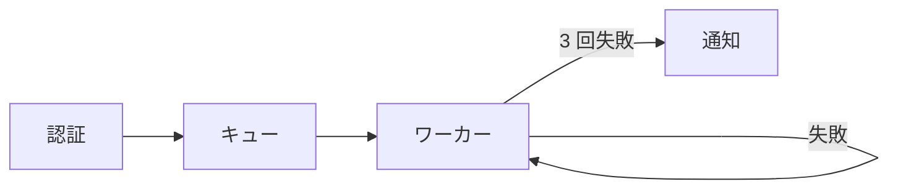

# 執筆ガイドライン

> このファイルは写しです。原本はハブ(Riku-Takata/claude-code-setup)の `knowledge/styles/ST-001-tech-article-exemplar.md`(ID: ST-001)で、各ルールの本文はその「9. 執筆ガイドライン(Rule)との対応」から作っています。書き方を変えるときは原本を直してから、ここに写してください。
>
> ルールの骨子は素案 5.1 のとおりです。ST-001 の手法とぶつかるときは、このファイルのルールを優先します。
>
> 各ルールの「悪い例」「良い例」は書き方の手本です。例に出てくる技術や出来事を記事の内容に持ち込まず、記事の中身は ADR から取ってください。

## 1. 構成(Structure)

### Rule-S01: 課題と結論を冒頭で示す

最初の `##` 見出し(「はじめに」)で、この記事が解く設計上の課題と、選んだ結論を 3 行以内で示します。読者が冒頭だけで「何の話で、どう決着したか」を掴めるようにするためです。

- 書く順番は **動機 → 問い → 範囲 → 結論**。動機は「なぜ今これを決める必要があったか」を 1〜2 文で書きます。
- 問いは疑問文で立てます(「この状態は、誰がどこに持つべきか」)。
- 範囲として、この記事で見る順番を一文で予告します(「比べた案、決めた理由、残った代償の順に見ていきます」)。
- 結論は太字の一文にして出します。仕組みを掘る記事でも結論は伏せません。
- 前提(題材のアプリ、比べる相手、検証したバージョン)が ADR にあれば、冒頭で書きます。
- 段階や判断の軸が複数ある話は、冒頭に一覧表を置いて全体の地図にします(段階・やること・代償の 3 列など)。

悪い例:

> 最近、状態管理について考える機会がありました。いろいろなライブラリがあり、それぞれに特徴があります。今回はそのあたりを見ていきたいと思います。

良い例:

> 画面をまたぐ下書きの状態を、どこに持つかで迷いました。この記事では、比べた 2 案と決めた理由、残った代償の順に見ていきます。**結論は、グローバルストアではなく URL に持つことにしました。**

### Rule-S02: 公式手順や初期設定は書かない

インストール手順、公式ドキュメントを見れば分かる初期設定、コマンドの羅列は書きません。読者が欲しいのは手順ではなく、この記事でしか分からない判断です。

- 設定に触れるときは、判断に効いた要点を 1 行だけ書きます(「`strict` を 1 行足すだけです」)。詳細は末尾の「参考」の節に公式ドキュメントのリンクとして回します。
- 機能を網羅して並べません。どれが効いたか、なぜそうなっているかに絞ります。
- 設定値を出すのは、その値が判断の理由になっているときだけです。

悪い例:

> まず `npm install zod` でインストールします。次に `tsconfig.json` を開き、以下の設定を追加します。(設定ファイル全体を貼る)

良い例:

> 型の検査が効くのは `tsconfig.json` の `strict` を有効にしたときだけです。今回これを前提にしたのは、入力の検証漏れを型で拾いたかったからです。

## 2. 技術的深掘り(Tech Depth)

### Rule-T01: 代替技術とトレードオフを書く

ライブラリや設計を選んだ記事では、比べた代替案を最低 1 つ挙げ、なぜそちらを選ばなかったのかを書きます。代替案は ADR の `options` から取り、ADR にない案は足しません。

- 比べるときは、同じ題材で 2 つの書き方を並べてから違いを説明します。
- 比較の結果は表にします。表の前に「何の表か」を一文、後に「表から何が読めるか」を一文書きます。数字を出すときは条件(ツール、バージョン、計測の環境)を添えます。
- 選んだ案の **代償・欠点・使わない場面** の節を必ず置きます。良い面だけで終わらせません。
- 判断の軸は 2 つ程度に絞り、「どの条件ならどちらを選ぶか」を条件と選ぶものの表で渡します。「一律に当てはめない」「必要になった分だけ進める」まで書きます。

悪い例:

> いろいろ比較した結果、A が一番良かったので A を採用しました。

良い例:

> B も候補でしたが、B は設定を 1 か所に集められない代わりに、起動が速いという性質があります。今回は起動の速さより設定の見通しを優先したので A にしました。ただし A は、設定が増えるほど読み込みが遅くなります。

| 条件 | 選ぶもの |
| --- | --- |
| 設定が 1 か所に収まる規模 | A |
| 起動の速さが要件にある | B |

### Rule-T02: 却下した AI の提案をアンチパターンとして書く

AI との壁打ちで、AI の最初の提案を却下した場面があれば(ADR の `ai_steering`)、それを「アンチパターン」として 1 つの節にして解説します。この記事でしか書けない部分なので、省きません。

- 運びは **却下した案 → 何が起きるか → 採った案 → 一般化** の順です。
- 却下した案は、コードがあれば短く示し、壊れる箇所にコメントで印を付けます(`// 🔴 ここで重複して送られる`)。
- 「何が起きるか」は、実際に出たエラーや問題を具体的に書きます。推測で補いません。
- 最後に一般化の一文で閉じます(「再試行に限らず、副作用のある処理一般に言えることです」)。読者が自分の場面に持ち帰れるようにします。
- AI の案を責める書き方にしません。どの前提が欠けていたかとして書きます。

悪い例:

> AI は最初に別の方法を提案しましたが、うまくいかなかったので却下しました。

良い例:

```ts
// AI が最初に出した案
await retry(() => sendMail(user)); // 🔴 タイムアウト後に届いていると、同じメールが 2 通送られる
```

> 送信がタイムアウトしても、実際には届いていることがあります。この案は「失敗したら何も起きていない」という前提に立っていました。そこで、送信ごとに ID を振り、同じ ID は 2 回送らない形にしました。**再試行は、冪等な処理にしか安全に効きません。**

## 3. 文体・トーン(Style & Tone)

### Rule-M01: です・ます調で AI 特有の表現を使わない

文末は落ち着いた「です・ます」調にし、本文は平叙文で言い切ります。AI が書いたと分かる決まり文句は使いません。

- 断定と推測を分けます。分かっていることは「〜です」「〜になります」、推測は「〜と思います」と書き分けます。
- よくある誤解を A、正しい理解を B に置いて **「A ではなく B」** で言い切ります(「値を書き換えているのではなく、次に使う値を予約しています」)。
- 具体のあとに「つまり」で一段抽象に引き上げます。調べて分かったことは「〜でした」で締めます。
- 太字は、記事の核になる一文だけに使います(1 節に 1〜2 か所)。用語の強調には使いません。
- 軽い口語は導入と「おわりに」だけにし、本文の説明では使いません。感嘆も本文では使いません。
- 英語の用語には初出で日本語の説明を、略語には初出で正式名を添えます。
- 使わない表現:「〜と言えるでしょう」「いかがでしたか？」「〜ではないでしょうか」「〜することが重要です」「様々な」「〜について解説します」、主張のない締め。

悪い例:

> キャッシュを適切に活用することが重要と言えるでしょう。いかがでしたか？

良い例:

> キャッシュが効いていたのは、読み込みではなく、2 回目の描画でした。つまり、遅さの原因は通信ではなかったことになります。

### Rule-M02: 段落は短く、転換点で箇条書きや図を使う

1 つの段落は最大 4 行(目安は 1〜3 文、90 字前後)にし、1 段落には 1 つのことだけを書きます。論理の転換点では、箇条書き・表・図に切り替えます。

- 見出しは主張の文にします(「設定ファイル」ではなく「設定は型として検査される」)。見出しだけ読めば主張がたどれるようにします。読者が抱く疑問をそのまま見出しにしても構いません。
- 箇条書きは、並列の項目が 3〜6 個あるときだけ使います。文章で書ける流れは箇条書きにしません。番号付きリストは順番に意味があるときだけにします。
- 構造・データの流れ・状態の置き場所は図にします。図は Mermaid を基本にし、ツリーやログ、エラー出力は言語に `plaintext` を付けたコードブロックで示します。
- コードブロックには必ず言語を付けます。コードの後には必ず観察か解釈の一文を置きます(「実行すると、エラーではなく空の配列が返ります。」)。
- API 名、変数名、コマンド、設定のキー、ファイル名はインラインコードにします。
- 本筋から外れる注意は、丸括弧の補足 1 段落にまとめて流れを止めません。

悪い例:

> リクエストを受けるとまず認証を確認し、通ったらキューに積み、ワーカーがそれを取り出して処理し、失敗したら再試行し、3 回失敗したら通知を送るという流れになっていて、この再試行の部分で問題が起きました。

良い例:

> 問題が起きたのは、ワーカーが再試行する部分でした。流れは次のとおりです。


